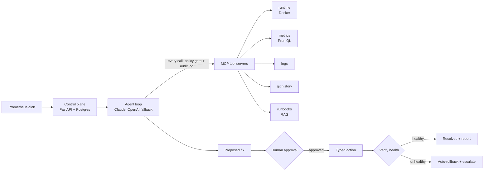

# SentinelOps

[](https://github.com/vraj138/SentinelOps/actions/workflows/ci.yml)

**An AI agent for incident response that gathers evidence before it acts, and never acts without a human's approval.**

When a production alert fires, SentinelOps investigates the way an on-call engineer would. It
queries metrics, reads logs, inspects containers, and checks recent deploys and runbooks. Then it
writes a root-cause analysis in which every claim cites the tool call that supports it. It
proposes one fix from a fixed set of typed actions and waits for a human to approve. After running
the fix, it checks that the service is healthy again, and rolls back automatically if it isn't.

A benchmark of injected faults measures how well this works, compared with the project's first
version.

> **Status: in active development.** The demo environment is running and tested. The agent,
> remediation, and benchmark are being built now. See the [roadmap](#roadmap).

---

## Why this exists

The first version of this project, **IncidentPilot** (kept in [`legacy/`](legacy/v1-incidentpilot/)),
was a RAG copilot: ChromaDB, gpt-4o-mini and a Streamlit UI. Reviewing it turned up a serious
failure:

- Its MCP client import failed (`FastMCPClient` does not exist in `mcp` 1.13.0), and the
  exception was **silently swallowed**.
- As a result, **no real metrics ever reached the model**, and it confidently invented "metric
  correlations."
- Smaller bugs were hiding behind that one: the time-window filter compared ISO strings to epoch
  integers, the vector index went stale with no chunking, and invalid JSON had no fallback.

> **Where v1's code lives:** the published IncidentPilot repository (the `legacy/` submodule)
> contains only v1's retrieval app. Its LLM orchestrator, where the bugs above are, was never
> committed there; the benchmark runs a snapshot of that local working copy and records its
> SHA-256 alongside the results.

An assistant that sounds right but has no evidence is worse than having no assistant.
SentinelOps is the answer to that failure:

| IncidentPilot (v1) | SentinelOps (v2) |
|---|---|
| Retrieves similar past incidents and guesses | Gathers live evidence through tools |
| Tool errors are swallowed | Errors are always surfaced, never hidden |
| Claims have no citations | Every claim cites the tool calls behind it |
| Advice only | Typed actions → human approval → verification → auto-rollback |
| Not measured | Benchmarked against v1 on injected faults |

## How it works

Full details are in the [design doc](docs/design.md).



Each incident moves through a strict sequence of states:

```
OPEN → INVESTIGATING → PROPOSED → APPROVED → EXECUTING → VERIFYING → RESOLVED | ESCALATED
```

## Safety model

These are design rules, enforced in code:

- **Diagnostics are read-only.** Investigating tools can look but never change anything.
- **No free-form commands.** The model can only choose from typed actions defined in code
  (`rollback`, `restart`, `set_flag`). There is no shell access and never `shell=True`.
- **A human approves every action**, and the approval is recorded before anything runs.
- **Every action is verified afterwards.** If verification fails, the system rolls back and
  escalates automatically.
- **Everything is audited.** Every LLM call and tool call is logged with timing, tokens and cost.
- **Errors are never silently swallowed.** This is the v1 bug this project exists to fix.

## The demo environment

SentinelOps needs something real to break and repair, so the repo ships a small microservice
stack that runs in Docker Compose:

```
loadgen ──► gateway ──► orders ──► payments
                          │
                          ▼
                      Postgres            Prometheus scrapes all three services every 5 s
```

- **gateway, orders and payments** are small FastAPI services. Each one exposes `/health` and
  `/metrics` (request counts, latency histograms, and `app_build_info` with the running version).
- **loadgen** sends steady checkout traffic so there are always real metrics.
- **Every image is tagged with its git commit**, so a deploy is a real commit plus a new image
  tag. That makes "what changed?" an answerable question.
- **Alert rules:** `ServiceDown`, `HighErrorRate` (>5% 5xx), `HighLatencyP95` (>1 s),
  `HighMemoryUsage` (>100 MiB of the 128 MiB limit) and `FrequentRestarts` (crash loops).
- **Every container has a memory limit.** The whole stack idles at about 365 MB, so it fits
  comfortably on an 8 GB laptop.

Failures are visible by design. When payments goes down, orders and gateway return a 502 with the
cause attached, and log it. Evidence of a fault always exists for the agent to find.

## Quickstart

**Requirements:** Python 3.12, [uv](https://docs.astral.sh/uv/), and a Docker runtime
([OrbStack](https://orbstack.dev/) or Docker Desktop). Everything runs on Apple Silicon (arm64).

```bash
git clone https://github.com/vraj138/SentinelOps.git
cd SentinelOps
cp .env.example .env     # add API keys (not needed for the demo stack)

make install             # install dependencies with uv
make test                # unit tests (no Docker needed)
make up                  # build and start the demo stack
make ps                  # check container health
```

Then try it:

```bash
curl -X POST localhost:8000/checkout     # place an order through the whole chain
open http://localhost:9090/alerts        # Prometheus alerts
```

Break something on purpose, then fix it through the approval flow (no API key needed: an
operator proposes the fix, and it takes the same approve -> execute -> verify path as the agent's):

```bash
make faults                                   # list the fault scenarios
make fault NAME=bad_deploy VARIANT=a          # ship a bad payments release
make controlplane                             # web UI at http://localhost:8080 (separate terminal)
make incidents ARGS="open --propose rollback:payments"   # open an incident with a dry run
# approve it on the incident page; it executes, verifies, and resolves (or rolls back + escalates)
make reset                                    # return the stack to its baseline
```

With an `ANTHROPIC_API_KEY` in `.env`, `make investigate` runs the agent on the firing alerts,
opens the incident, and proposes the fix from its cited root-cause analysis.

Or simulate an outage by hand and watch the alerts fire:

```bash
docker compose -f infra/docker-compose.yml stop payments    # ServiceDown fires in ~35 s
docker compose -f infra/docker-compose.yml start payments   # clears about a minute later
make down                                                   # stop everything
```

| Service | URL |
|---|---|
| gateway | http://localhost:8000 |
| orders | http://localhost:8001 |
| payments | http://localhost:8002 |
| Prometheus | http://localhost:9090 |
| Control plane (approvals) | http://localhost:8080 (`make controlplane`) |
| Demo Postgres | `localhost:5432` |
| Control-plane Postgres | `localhost:5433` |

## Roadmap

- [x] Project skeleton: uv, ruff, pytest, typed settings
- [x] Demo stack: three services, Postgres, Prometheus, alert rules, load generator
- [x] [Design doc](docs/design.md)
- [x] Fault injectors: bad deploy, memory leak (OOM), DB connection exhaustion, slow dependency,
      bad feature flag, missing secret, with answer keys. Some variants include a red-herring deploy.
- [x] Read-only MCP tool servers: metrics, runtime, logs, changes (deploys + flags), runbooks
- [x] Agent loop with a cited root-cause analysis, policy gate, audit log, budgets, model fallback
- [x] Control plane: typed actions, web approval page, fingerprinted approvals, verification,
      auto-rollback
- [x] Benchmark harness: clean-slate runs, scoring vs answer keys, judge, v1 baseline, replay
- [x] SentinelOps benchmark: 10 scenarios, 1 run each
- [ ] v1 baseline comparison and more repeats (needs an OpenAI key)
- [x] Docs: [deployment guide](docs/deployment.md), [limitations](docs/limitations.md)
- [x] CI: lint and tests on every push
- [ ] Demo video ([script](docs/demo.md) ready)

## Results

**SentinelOps, measured on 2026-10-14:** 10 fault scenarios, **1 run each**, Claude Opus 5.5
(`claude-opus-5-5`, effort `high`). Each run starts from a clean slate (fresh deploy history,
logs, events and metrics), injects the fault, waits for a real alert, then investigates.

| metric | SentinelOps |
|---|---|
| correct root-cause service | 100% (10/10) |
| correct proposed action | 100% (10/10) |
| harmful proposal (e.g. rolling back the red-herring deploy) | 0% (0/10) |
| correct escalation (escalate only when nothing we control caused it) | 100% (10/10) |
| median time from alert to answer | 33 s |
| mean cost per incident | $0.10 |
| mean tool calls / citations per answer | 10.3 / 10.8 |

Scenarios: bad deploy (3 variants, one with a red-herring deploy), memory leak, DB connection
exhaustion, slow external dependency (2, one with a red herring), bad feature flag (2), missing
secret. Per-run details: [`evals/results/summary.md`](evals/results/summary.md).

**Read these numbers with their limits:**
- **10 runs, one per scenario.** That's enough to show it works end to end, not a tight
  accuracy estimate. More repeats and harder variants are the next step.
- **I wrote the scenarios and the agent.** Answer keys were fixed before any run, and red
  herrings punish shortcuts, but the faults are known to be diagnosable.
- **Deploy commit messages are descriptive** ("Keep all receipts in memory..."), which makes
  diagnosis easier than with typical real-world commits.
- **Proposals are scored, not executed.** Executing them, with approval, verification and
  auto-rollback, is shown separately in the control plane's live tests.
- **v1 baseline: not yet run** (needs an OpenAI key). The comparison table will be added when
  it is measured, with the same alerts and the same judge for both systems.

```bash
make bench-dry                              # free: scripted model, proves the harness
make bench ARGS="--confirm-spend"           # paid: SentinelOps on every scenario
make report                                 # summary table -> evals/results/summary.md
```

How runs are isolated and scored: [design doc section 7](docs/design.md#7-evaluation-plan).

## Project layout

```
sentinelops/     control plane, agent, policy gate, evals (in progress)
mcp_servers/     one MCP server per tool domain (planned)
demo_app/        gateway, orders, payments, loadgen: the services we break on purpose
infra/           docker-compose.yml, Prometheus config and alert rules, Postgres init
faults/          fault injectors, one module per scenario (planned)
evals/           scenarios, recordings for replay, results
tests/           pytest suite
legacy/          v1 IncidentPilot, kept unchanged as the eval baseline
```

## Development

```bash
make lint      # ruff check + format check
make format    # auto-format and fix
make test      # pytest
```

Python 3.12 · FastAPI · Pydantic v2 · httpx · Prometheus · Postgres · Docker Compose ·
MCP Python SDK · Claude (primary) with OpenAI fallback

**Scope choices:** this version runs on Docker Compose rather than Kubernetes, and leaves out
Loki, Grafana, Slack and Jira integrations so the whole stack fits on a laptop. Infrastructure is
reached through backend interfaces, so other runtimes can be added later without touching the
agent.

## License

[Apache 2.0](LICENSE)
